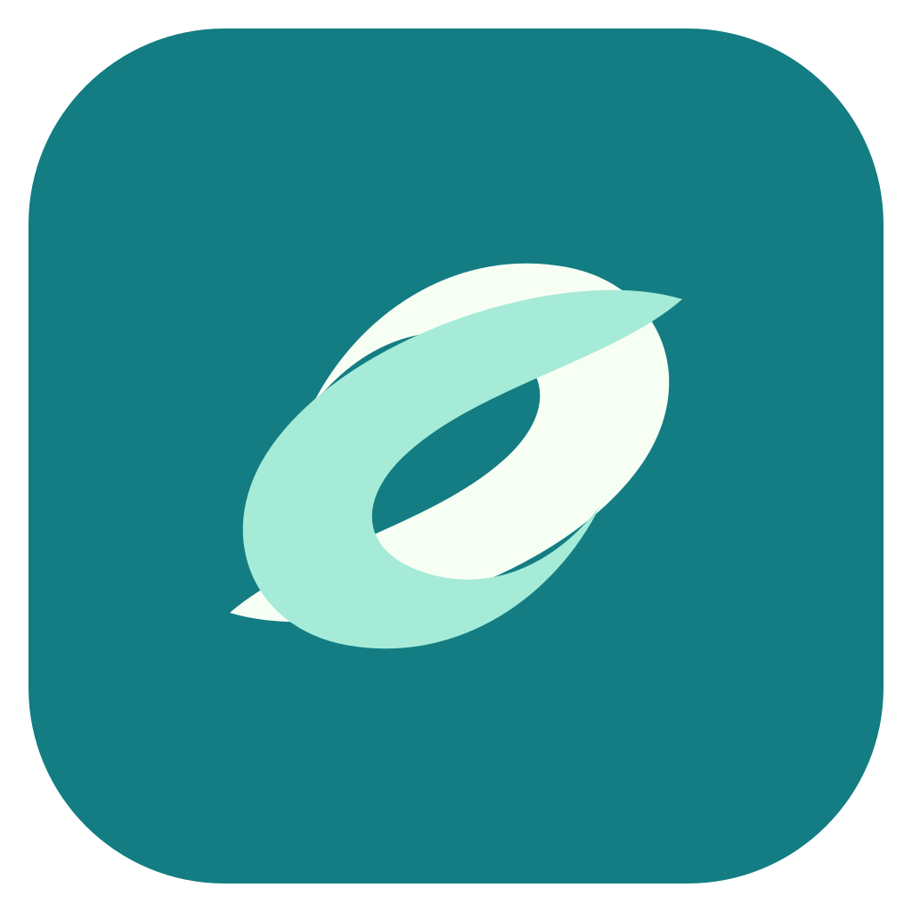
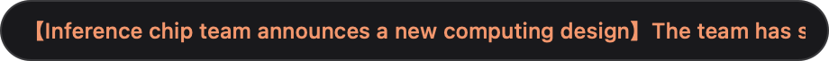
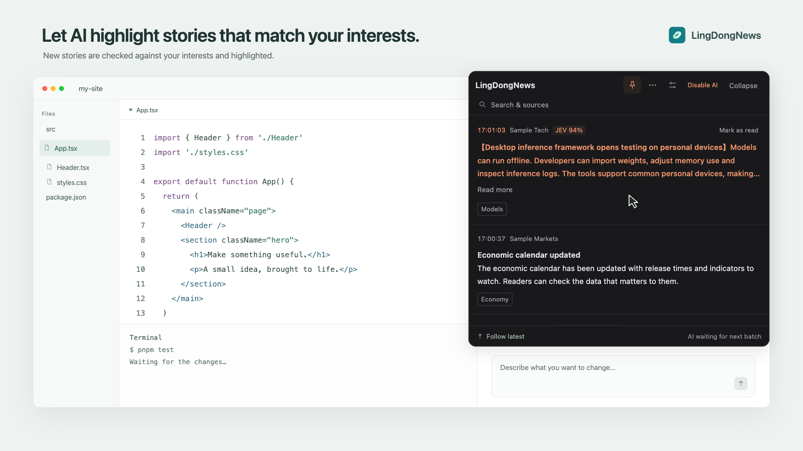
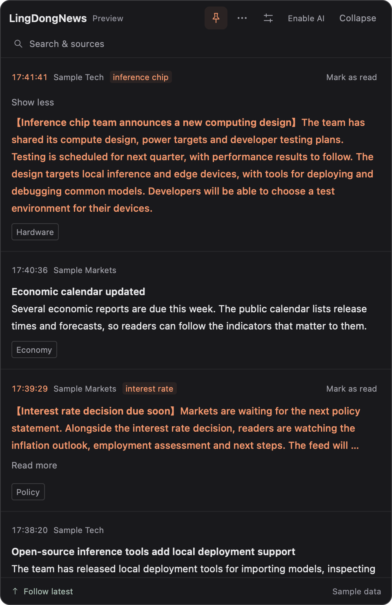
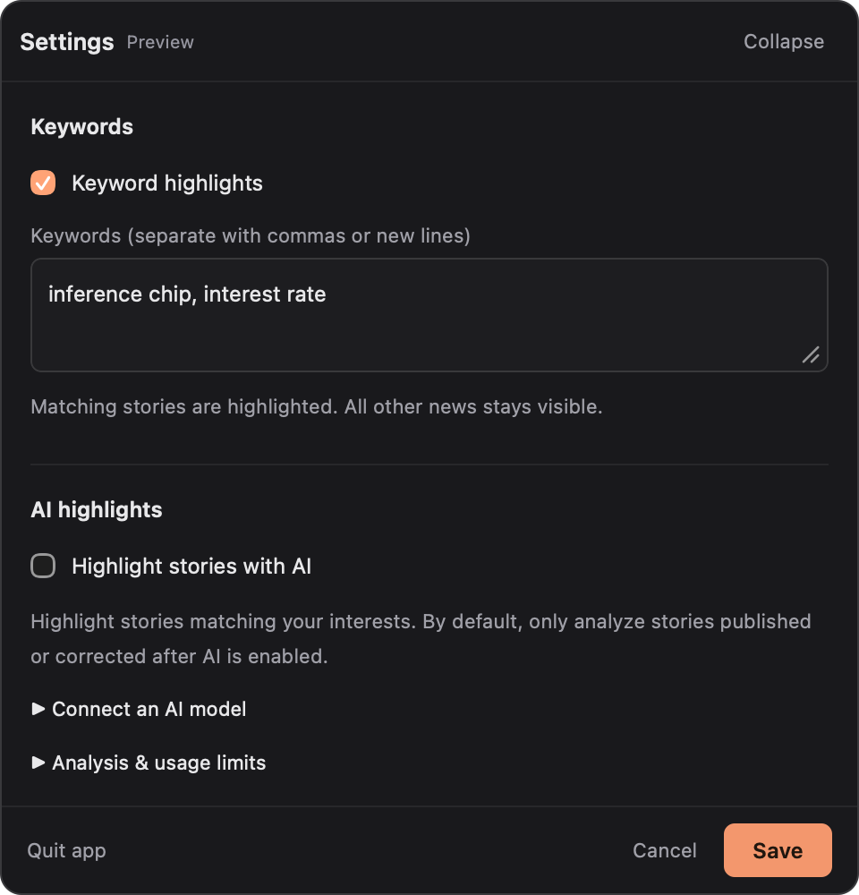
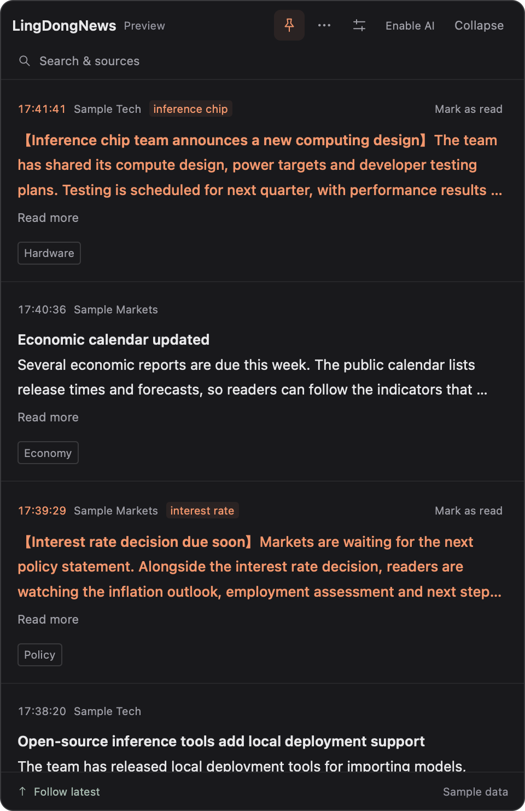
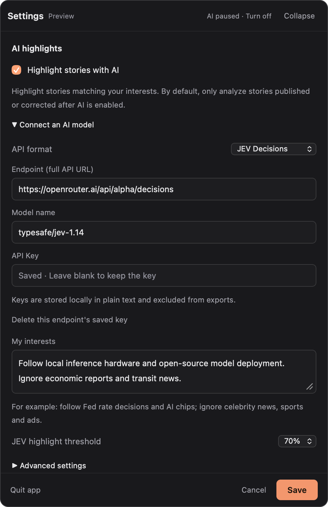
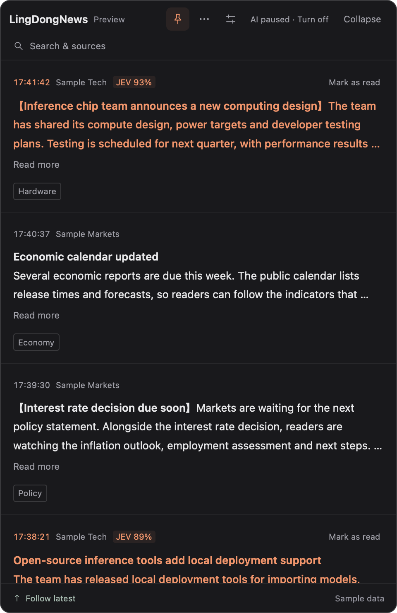
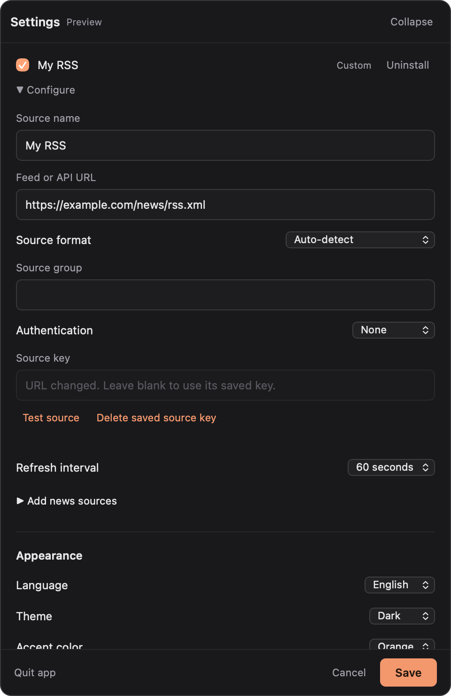

  

<h1 align="center">LingDongNews · 灵动新闻</h1>

lingdong-news · 0.1.1

A few minutes while your agent works. A quick look at the news.

  <a href="README.md">简体中文</a> · English 
  <a href="https://github.com/yellinzero/lingdong-news/releases">Download</a> ·
  <a href="https://www.youtube.com/watch?v=kb6YXzWzQ-0">Demo video</a> ·
  <a href="docs/en/usage.md">User guide</a> ·
  <a href="docs/en/news-source-development.md">Build a news source</a> ·
  <a href="docs/en/development.md">Development</a>

A desktop news ticker with automatic updates, single-line scrolling and keyword or AI highlights.

## Demo

[Watch the English demo](https://www.youtube.com/watch?v=kb6YXzWzQ-0) · [中文演示](https://www.youtube.com/watch?v=5_2iOTCwTzM)

## Get started

1. Choose sources in Settings.
2. Adjust the window and scrolling speed.
3. Enable keyword or AI highlighting as needed.

## A small floating window that stays out of your way

News scrolls on one line; click a story to read its full text. The window stays on top by default, with adjustable size, position and scrolling speed.

## Highlight topics with keywords

Enter terms in Settings → Keywords, such as `inference chip, interest rate`. Matches are highlighted; other stories stay visible.

<table>
  <tr><th>Choose your terms</th><th>See matches in the feed</th></tr>
  <tr>
    <td width="50%" valign="top"></td>
    <td width="50%" valign="top"></td>
  </tr>
</table>

## Let AI identify stories that interest you

Enter your API URL, model, key and interests. AI highlights relevant stories in batches. Supports **Chat Completions, Messages, Responses and JEV Decisions**.

Set rate and character limits, or turn AI off with one click. Highlights and saved decisions remain; identical content reuses results.

<table>
  <tr><th>Configure AI and your interests</th><th>Highlight relevant stories by meaning</th></tr>
  <tr>
    <td width="50%" valign="top"></td>
    <td width="50%" valign="top"></td>
  </tr>
</table>

[Configuration and limits](docs/en/usage.md#keywords-and-ai) · [API contracts](docs/en/integrations.md#ai-protocols)

## Add the news sources you read

CLS, WallstreetCN and Jin10 are preinstalled. Add multiple RSS / Atom / JSON Feed subscriptions, JSON endpoints or custom adapters. Sources can be enabled, uninstalled and reinstalled.

[Source development guide](docs/en/news-source-development.md) · [Runnable examples](source-adapters/README.en.md)

## Developer documentation

[Develop, test and build](docs/en/development.md) · [Versions and CI](docs/en/releasing.md)

## License

Project code and original icons are licensed under [MIT](LICENSE).
