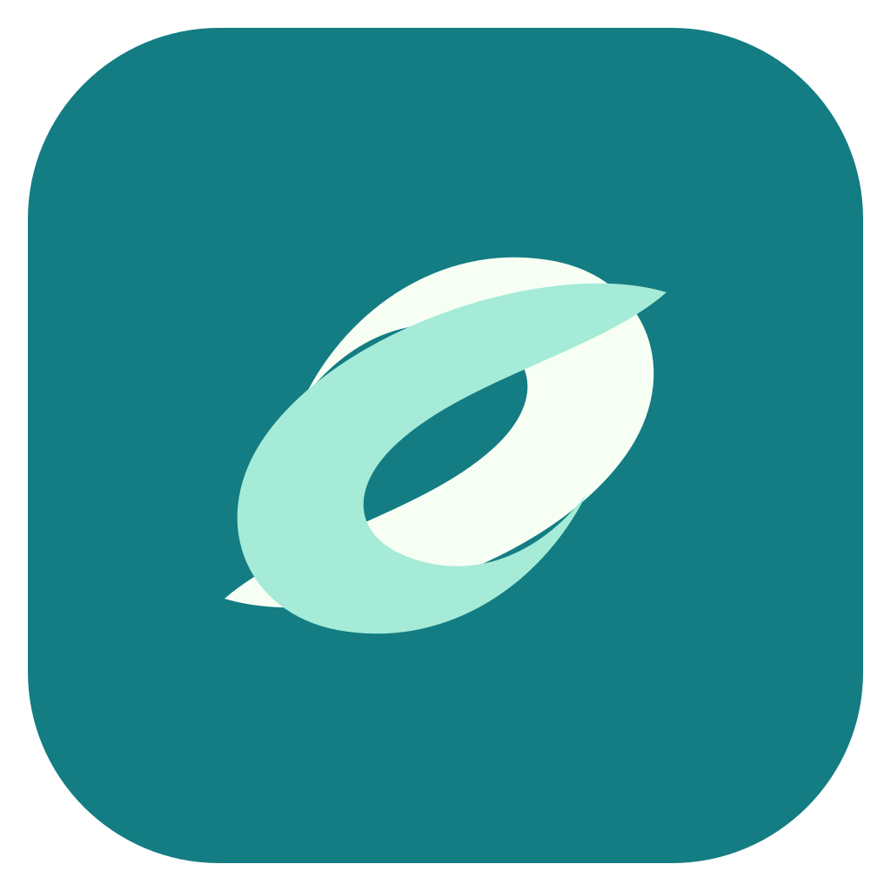
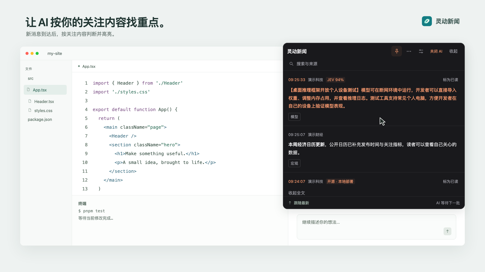
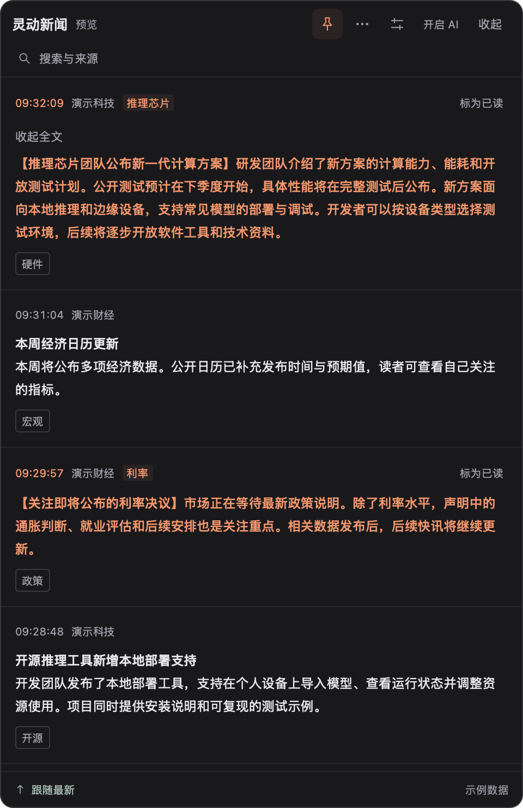
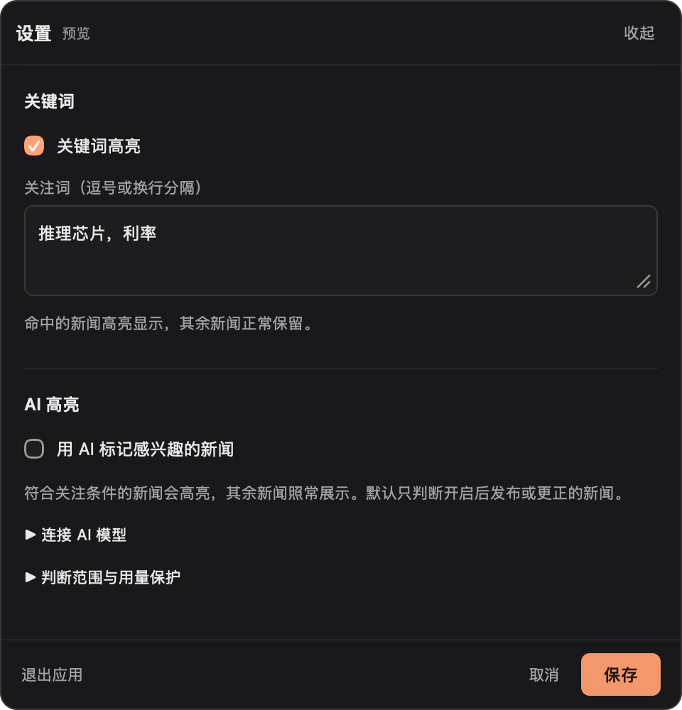
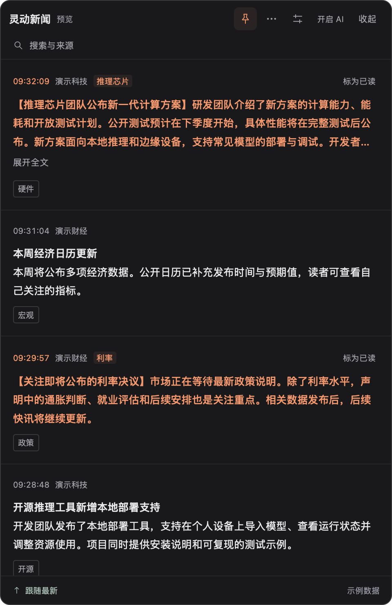
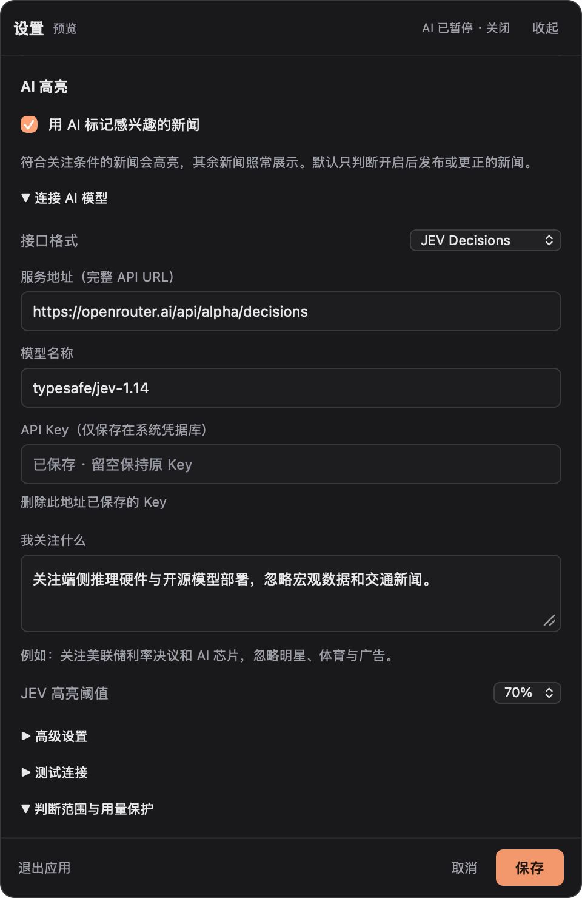
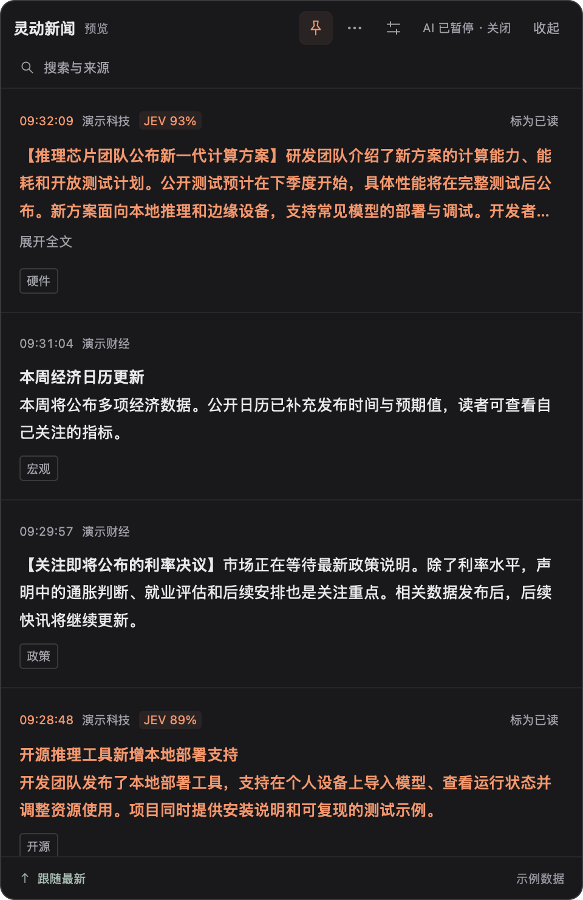
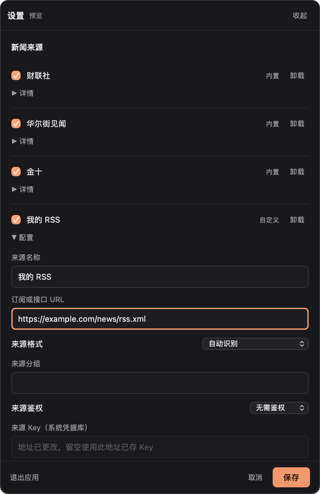

  

<h1 align="center">灵动新闻</h1>

lingdong-news · 0.1.1

等 Agent 干活的几分钟，想看看新闻，又不想打开一堆网站？

  简体中文 · <a href="README.en.md">English</a> 
  <a href="https://github.com/yellinzero/lingdong-news/releases">下载</a> ·
  <a href="https://www.youtube.com/watch?v=5_2iOTCwTzM">演示视频</a> ·
  <a href="docs/usage.md">使用说明</a> ·
  <a href="docs/news-source-development.md">开发新闻源</a> ·
  <a href="docs/development.md">本地开发</a>

桌面快讯悬浮窗，支持自动更新、单行滚动和关键词／AI 高亮。

## 演示视频

[观看中文演示](https://www.youtube.com/watch?v=5_2iOTCwTzM) · [English demo](https://www.youtube.com/watch?v=kb6YXzWzQ-0)

## 开始使用

1. 在设置中选择新闻来源。
2. 调整窗口位置、大小和滚动速度。
3. 按需开启关键词或 AI 高亮。

## 小小的悬浮窗口，不打扰正在进行的工作

收起时单行滚动播放新闻，点击即可展开全文。支持拖动、调整大小和滚动速度，默认置顶。

## 用关键词高亮感兴趣的新闻

在“设置 → 关键词”中填写关注词，如 `推理芯片，利率`。相关新闻高亮，其他新闻正常展示。

<table>
  <tr><th>关键词设置</th><th>高亮效果</th></tr>
  <tr>
    <td width="50%" valign="top"></td>
    <td width="50%" valign="top"></td>
  </tr>
</table>

## 让 AI 帮你识别感兴趣的新闻

填写服务地址、模型、API Key 和关注内容，AI 会批量判断并高亮相关新闻。支持 **Chat Completions、Messages、Responses 和 JEV Decisions**。

可设置频率和字数上限，一键关闭。已有高亮和判断结果保留，相同内容复用结果。

<table>
  <tr><th>填写模型和关注内容</th><th>AI 高亮效果</th></tr>
  <tr>
    <td width="50%" valign="top"></td>
    <td width="50%" valign="top"></td>
  </tr>
</table>

[配置与用量控制](docs/usage.md#关键词和-ai-高亮) · [接口与输出格式](docs/integrations.md#ai-协议与系统提示词)

## 添加你常看的新闻来源

预装财联社、华尔街见闻和金十；支持多个 RSS / Atom / JSON Feed 订阅、JSON 接口和自定义适配器。来源可启用、卸载或重新安装。

[新闻源开发指南](docs/news-source-development.md) · [可运行示例](source-adapters/README.md)

## 开发文档

[开发、测试与打包](docs/development.md) · [版本与 CI](docs/releasing.md) · [English documentation](docs/en/usage.md)

## 许可

项目代码与原创图标采用 [MIT License](LICENSE)。
