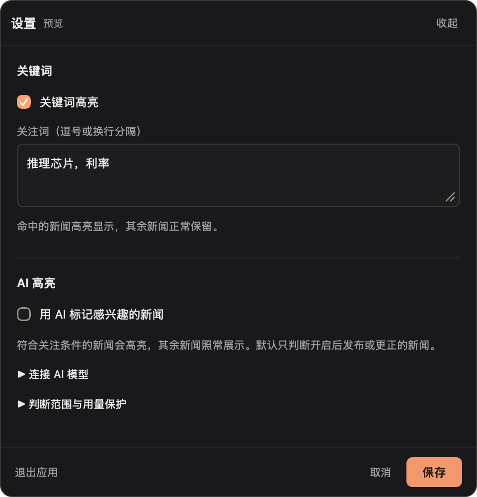
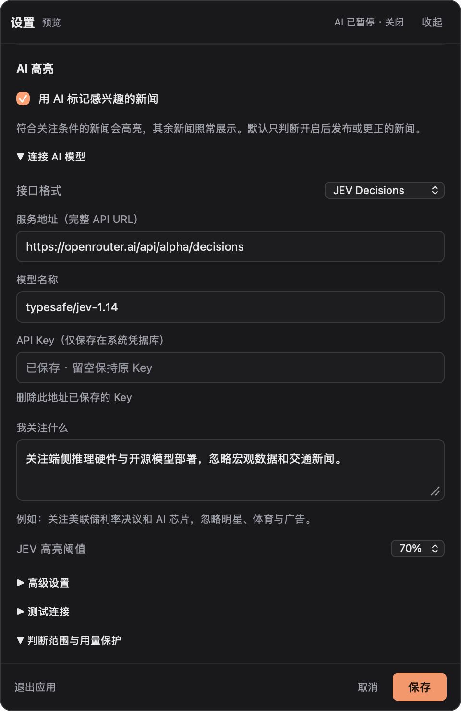
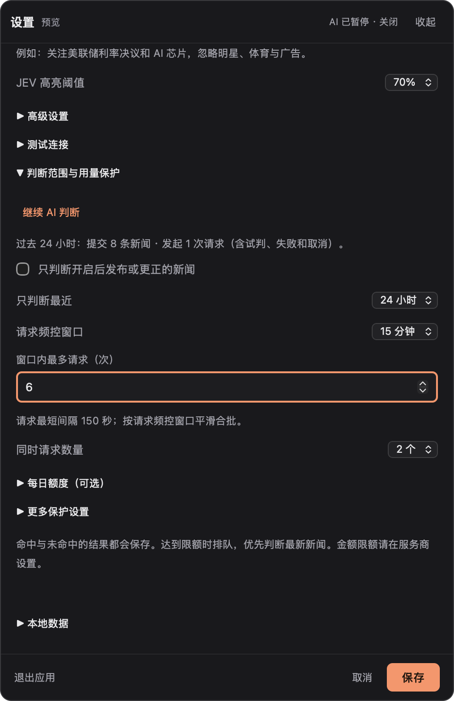

# User guide

[简体中文](../usage.md) · English

## Read news

| Action | Result |
| --- | --- |
| Drag the window / its edges | Move / resize |
| Hover and click arrows, or use arrow keys | Previous / next story |
| Click a story | Open full text |
| Right-click | Settings, AI controls, pause updates |
| ⌘F / Ctrl+F | Search |
| Esc | Collapse the window or close a menu |

The ticker skips completed and duplicate stories by default, finishing the current story before new arrivals. Long stories start collapsed in the reader. Disable “自动展示最新” to keep your reading position when news arrives.

## Add sources

Open “设置 → 新闻来源 → 添加新闻来源”. Save changes to apply them. Uninstalled sources can be reinstalled.

| Source | Add it with |
| --- | --- |
| CLS, WallstreetCN, Jin10 | Preinstalled toggles |
| RSS / Atom / JSON Feed | URLs, bulk entry or OPML |
| Standard JSON | Name, URL and format |
| Custom adapter | A `.news-source.json` file |

[Build a source](news-source-development.md)

## Keywords and AI

Both are off by default. Matches are highlighted; other stories remain visible.

**Keywords:** enable “关键词高亮” and enter comma- or newline-separated terms.

**AI:** enter the complete API URL, model, key and interests. Supports Chat, Messages, Responses and JEV; one saved configuration.

Set news age, request rate and character limits in “判断范围与用量保护”. By default, only stories published or corrected after activation and within the last 30 minutes are analyzed. [Protocols and defaults](integrations.md#batching-and-limits)

“开启 AI” uses saved settings or opens configuration when needed. “关闭 AI” or ⌘⇧K / Ctrl+Shift+K stops calls while preserving highlights and decisions.

## Appearance and storage

Settings controls theme, accent and scrolling speed. Click the pin to toggle always-on-top. Window dimensions are saved automatically.

“本地数据” shows the storage path. Keys use the OS credential store.

| Platform | Default directory |
| --- | --- |
| macOS | `~/Library/Application Support/local.newsfloat.mac/` |
| Windows | `%APPDATA%/local.newsfloat.mac/` |
| Linux | `~/.local/share/local.newsfloat.mac/` (supports `$XDG_DATA_HOME`) |
