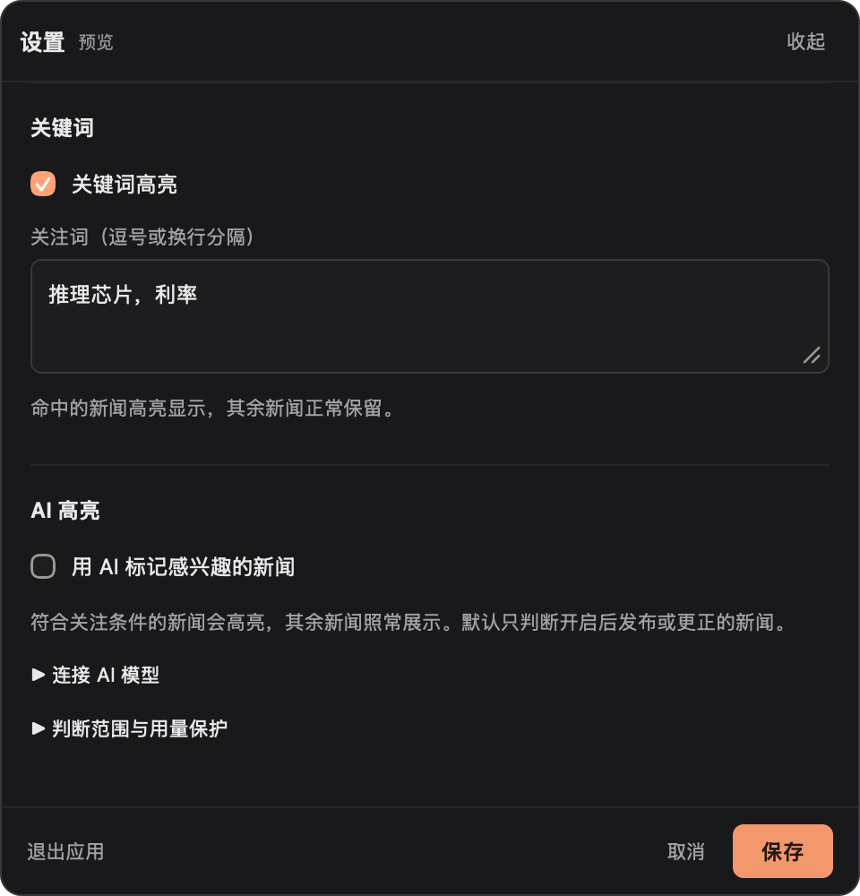
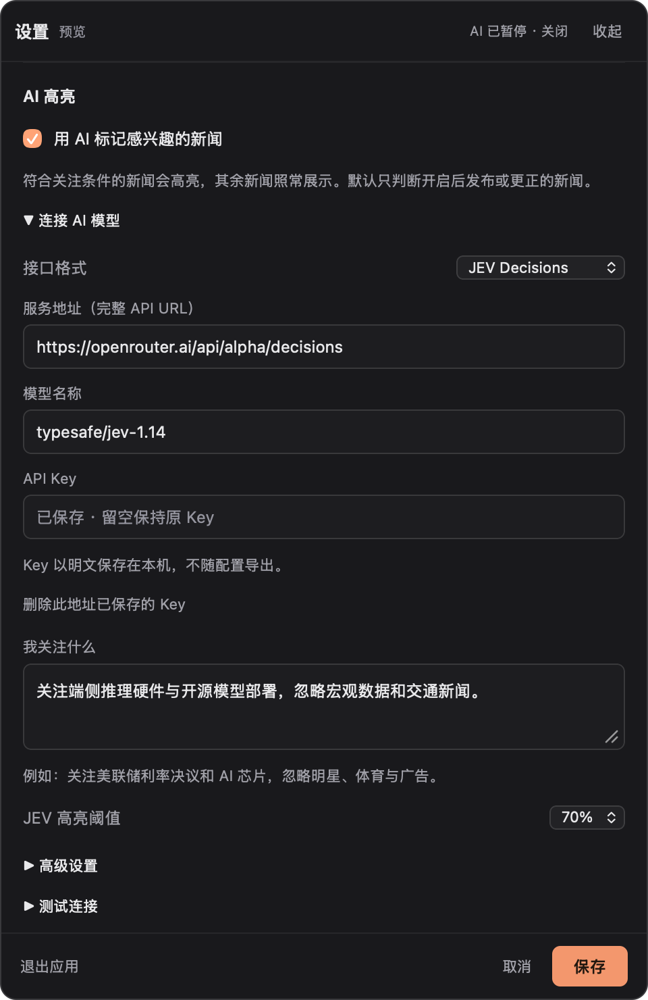
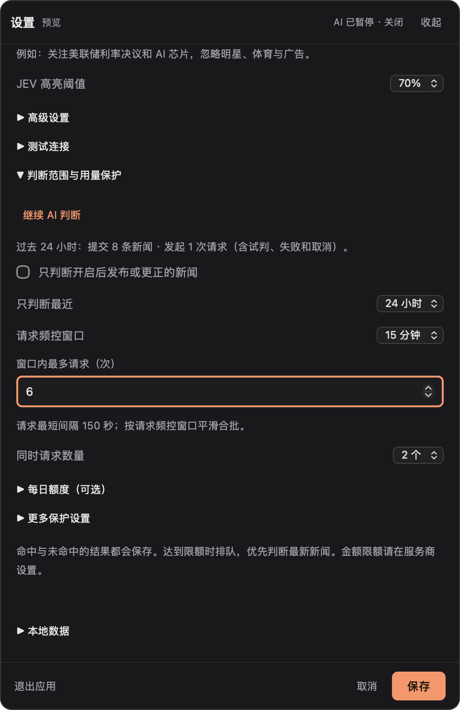

# 使用说明

简体中文 · [English](en/usage.md)

## 看新闻

| 操作 | 作用 |
| --- | --- |
| 拖动窗口／边缘 | 移动／调整大小 |
| 悬停后点左右箭头，或按方向键 | 切换新闻 |
| 点击新闻 | 展开全文 |
| 右键 | 设置、开关 AI、暂停更新 |
| ⌘F / Ctrl+F | 搜索 |
| Esc | 收起窗口或关闭菜单 |

收起时单行滚动，默认跳过已播完和重复的新闻；当前条播完后优先播放新消息。展开后长文默认收起，有新消息时回到顶部；关闭“自动展示最新”可保留阅读位置。

## 添加新闻源

入口：“设置 → 新闻来源 → 添加新闻来源”。修改后点“保存”，卸载的来源可重新安装。

| 来源 | 添加方式 |
| --- | --- |
| 财联社、华尔街见闻、金十 | 预装，勾选启用 |
| RSS / Atom / JSON Feed | 填地址，支持批量和 OPML |
| 标准 JSON | 填名称、地址和格式 |
| 自定义适配器 | 从文件添加 `.news-source.json` |

[开发新闻源](news-source-development.md)

## 关键词和 AI 高亮

两项默认关闭，只高亮相关新闻，不隐藏其他消息。

**关键词**：开启“关键词高亮”，填写关注词，以逗号或换行分隔。

**AI**：填写完整 API URL、模型、Key 和关注内容。支持 Chat、Messages、Responses、JEV，一次保存一套配置。

在“判断范围与用量保护”中设置新闻时间范围、调用频率和字数上限。默认只判断最近 30 分钟内、开启后发布或更正的新闻。[协议与默认值](integrations.md#批量和调用限制)

点“开启 AI”使用已存配置，缺少配置时进入设置。点“关闭 AI”或按 ⌘⇧K / Ctrl+Shift+K 停止调用，已有高亮和判断结果保留。

## 外观和数据

在设置中调整主题、强调色和滚动速度；点击图钉切换置顶。窗口尺寸自动保存。

“本地数据”显示保存路径；Key 以明文保存在本机的独立文件中，不随配置导出。

| 系统 | 默认目录 |
| --- | --- |
| macOS | `~/Library/Application Support/local.newsfloat.mac/` |
| Windows | `%APPDATA%/local.newsfloat.mac/` |
| Linux | `~/.local/share/local.newsfloat.mac/`（支持 `$XDG_DATA_HOME`） |
